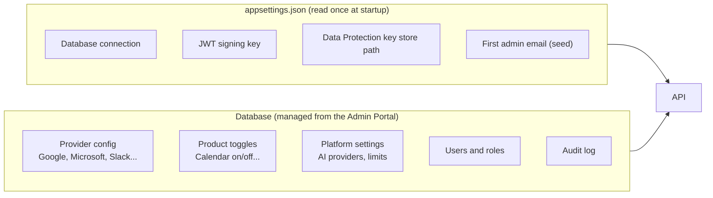
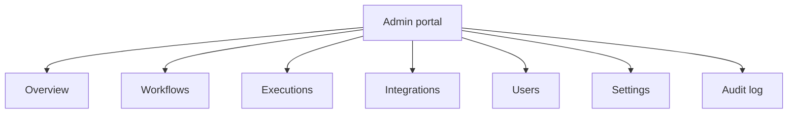
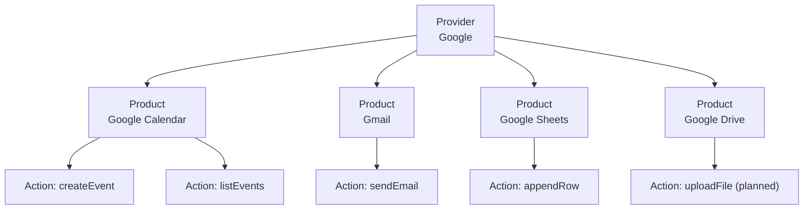
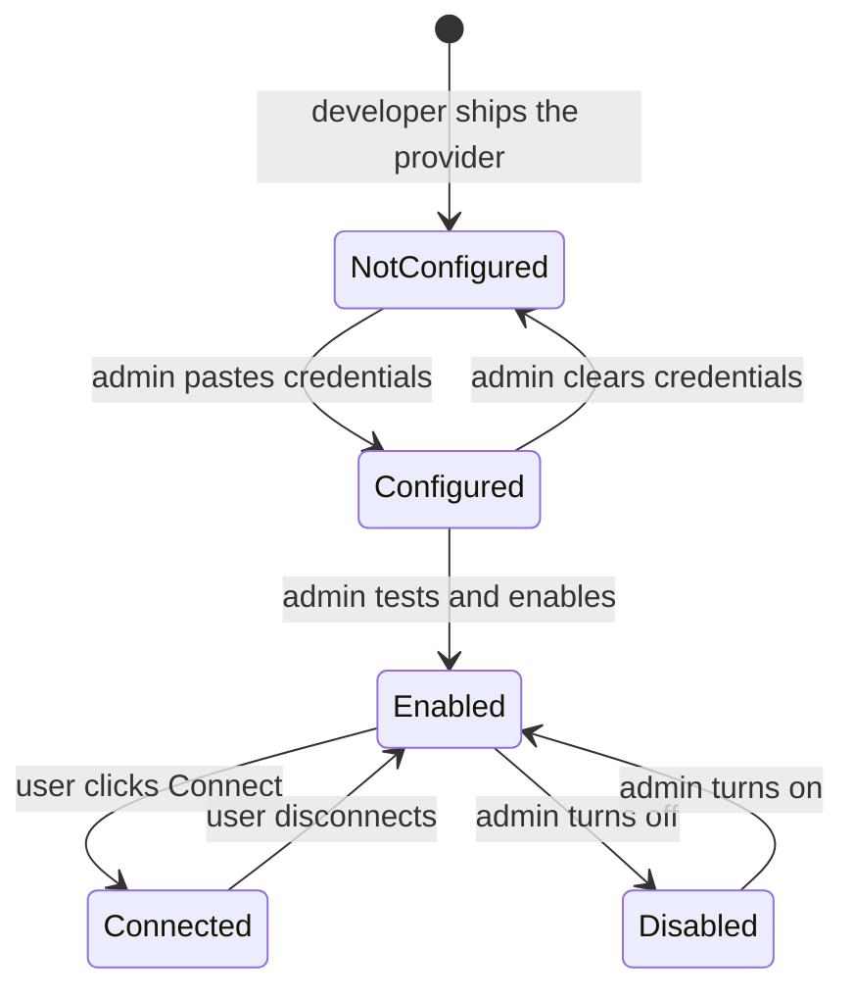
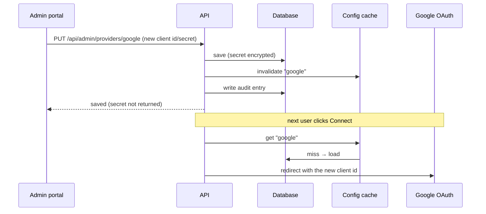
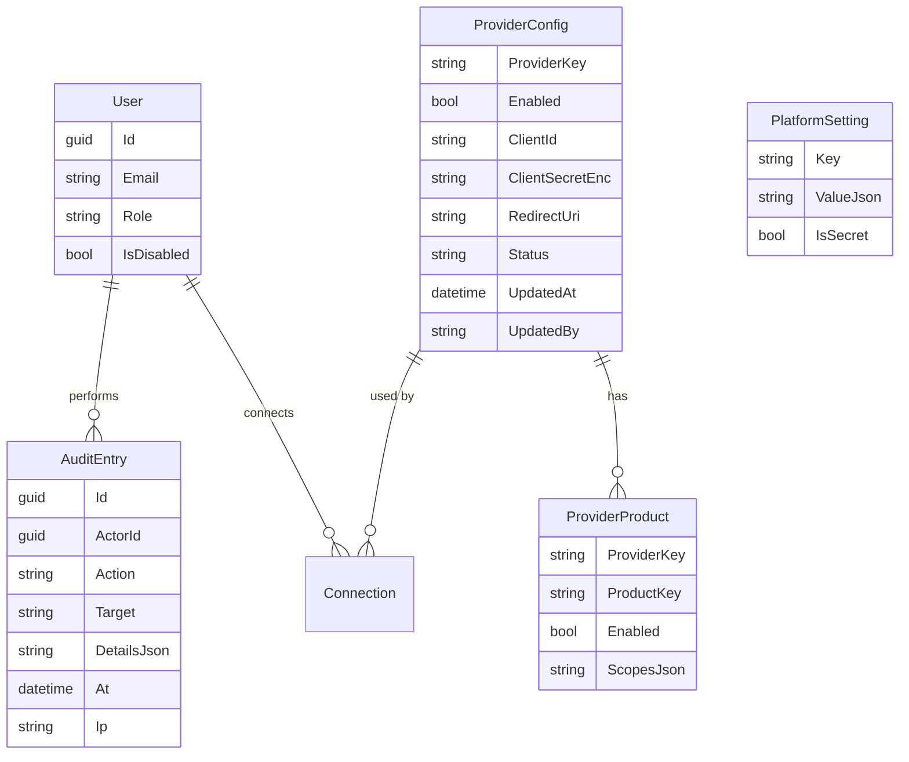

# Admin Portal & Integration Management — Design Proposal

Written for: you, the product owner and developer, to decide the design before anything is built.
Nothing here is implemented yet. Each open decision is marked **DECIDE**, with my recommendation.

---

## 1. The problem in one paragraph

Right now, adding a platform like Google means editing `appsettings.json` or user secrets, then
restarting the API. Only a developer can do that, and it has to be done again for every
environment. Workflows have no admin view: each user only sees their own. Your goal is a **portal
where an admin can**:

1. see every workflow that exists, who owns it, and whether it's healthy,
2. add and configure integrations (Google, Microsoft, Slack…) **from the UI**, with no file edits
   and no restart,
3. control which products of a platform users can connect (Google has Calendar, Gmail, Drive,
   Sheets, and more),
4. see what changed, and who changed it.

---

## 2. Principles

| Principle | Why |
|---|---|
| **Config lives in the database, not in files.** | Changes take effect immediately, and the UI can edit them. |
| **`appsettings.json` only holds what the app needs to start.** | Database connection and JWT signing key. Nothing an admin changes day to day. |
| **Secrets are write-only.** | Once saved, a client secret can be replaced but never shown again. |
| **Every admin change is audited.** | You can answer "who turned off Gmail?" |
| **Least privilege for users.** | A user only gets the scopes for products the admin enabled. |
| **Code defines what's possible; admins decide what's allowed.** | Developers write the actions (`google.gmail.sendEmail`). Admins switch them on, configure them, and give them to users. |

### What stays in config files (bootstrap only)



**Why:** the first group must exist before the app can reach the database, so it can't live there.
Everything else changes at runtime and belongs in the database.

---

## 3. Roles and access

Today every user is the same and sees only their own workflows. We add a role.

| Role | Can do |
|---|---|
| **Member** (default) | Build workflows, run them, connect *their own* accounts for enabled integrations. |
| **Admin** | Everything a member can do, plus: view all workflows, manage providers and products, manage users, read the audit log. |

**Implementation:** add `Role` to `User`. Put it in the JWT as a claim. Protect admin endpoints with
`[Authorize(Roles = "Admin")]`. The UI hides admin pages from members, but the **API is the real
check**, so a member who types an admin URL still gets `403`.

**DECIDE — how the first admin is created**
- **A. Seed from config (recommended):** `Admin:SeedEmail` in config. The first user who registers
  with that email becomes admin. Simple, safe, no UI needed to bootstrap.
- B. Create the first admin with a command-line tool.
- C. The first user to register becomes admin. Risky on a public server; avoid.

**DECIDE — tenancy**
- **Single company (recommended for now):** one admin team manages the whole platform.
- Multi-tenant SaaS: each customer has its own admins and its own integrations. Much bigger
  change: every table gets a `TenantId`. Decide before building, because it affects every table.

---

## 4. Admin portal: what's on each page



### 4.1 Overview (dashboard)
- Counts: workflows, active workflows, runs today, failures today, connected accounts.
- A list of **recent failures** with a link to each run.
- Health of each integration: "Google — 3 connected accounts, last token refresh failed 2h ago".

### 4.2 Workflows (all users)
A table with one row per workflow:

| Name | Owner | Status | Trigger | Last run | Success rate (7d) | Actions |
|---|---|---|---|---|---|---|
| New order processing | asha@… | Active | Webhook | 2 min ago, Succeeded | 98% | View · Disable · Re-run · Delete |

- **Filters:** owner, status, trigger type, uses integration X (e.g. "every workflow that uses
  Gmail"), has failed in last 24h.
- **Kill switch:** disable one workflow, which stops its webhooks and schedules at once.
- **Open read-only view:** see the graph and recent runs. Editing another user's workflow is a
  separate decision (see DECIDE below).
- **Impact check before disabling a provider:** "Disabling Gmail affects 4 workflows. Show them?"

**DECIDE — can admins see the contents of users' workflows?**
Workflows can contain customer data and API keys. Options:
- **A. Admins see everything (recommended for a company-internal tool).** Log every view in the audit log.
- B. Admins see only metadata (name, owner, status, counts). Contents need the owner's permission.
  Safer for a public SaaS.

### 4.3 Executions
The same list as today, but across all users, with filters by workflow, status, and date. Admins
can re-run a failed run.

### 4.4 Integrations (the core of this design — see section 5)

### 4.5 Users
- List users, their role, creation date, and last login.
- Promote or demote an admin. You can't remove the last admin.
- Disable a user (blocks login, pauses their webhooks and schedules, keeps their data).

### 4.6 Settings
- **AI providers:** default model, which providers are enabled, default API key *(stored
  encrypted, write-only)*.
- **Limits:** max runs per minute per user, max workflow size, max agent tool steps.
- **Webhooks:** public base URL shown to users (`https://your-domain/api/webhooks`).

### 4.7 Audit log
Every admin action: who, what, when, from which IP, old value → new value. Secrets are never
written to the log, only "client secret changed".

| Time | Admin | Action | Target | Change |
|---|---|---|---|---|
| 10:02 | you@… | provider.updated | Google | redirect URI changed |
| 10:05 | you@… | product.disabled | Google Drive | — |
| 10:09 | you@… | workflow.disabled | New order processing | — |

---

## 5. Integrations: how to manage platforms with many products

This is the hard part you asked about. Google has Calendar, Gmail, Drive, Sheets, Docs, Meet, and
many more. Microsoft has Outlook, Teams, OneDrive, SharePoint, Excel, and others. Slack has one
product. The design must handle both.

### 5.1 The model: Provider → Product → Action



| Level | Who defines it | Example | Stored where |
|---|---|---|---|
| **Provider** | Developer (code) + admin (credentials) | Google | `ProviderConfig` table |
| **Product** | Developer (what exists) + admin (on/off) | Gmail | `ProviderProduct` table |
| **Action** | Developer (code) | `google.gmail.sendEmail` | code (`IIntegrationAction`) |

- **Actions are code.** They can't be created from the UI, because they call real APIs.
- **Products and providers are data.** An admin can turn them on, off, or configure them.

### 5.2 Three ways to show the "many products" problem

**Option A — One card per provider, products inside (recommended)**

```
┌──────────────────────────────────────────────┐
│ [G]  Google                  ● Configured    │
│ Connect your Google account once.            │
│                                              │
│  ☑ Calendar   ☑ Gmail   ☑ Sheets   ☐ Drive   │
│                                              │
│  [ Edit credentials ]   [ Connect ]          │
└──────────────────────────────────────────────┘
```

- One card per platform. Product checkboxes control what users can use.
- Enabling a product adds its scopes to the consent screen. Disabling it removes them.
- Clean for the admin, and the card count stays small.
- **Downside:** a long product list inside one card. Solve with a "Show all" expander.

**Option B — A card per product, grouped under the provider**

```
Google
  ┌ Calendar ┐ ┌ Gmail ┐ ┌ Sheets ┐ ┌ Drive ┐
  │ 2 actions│ │ 1 act.│ │ 1 act. │ │ off   │
  └──────────┘ └───────┘ └────────┘ └───────┘
Microsoft
  ┌ Outlook ┐ ┌ Teams ┐ ...
```

- Each product is easy to see and configure on its own.
- More cards to scroll through. Best when providers have many products (e.g. Microsoft).

**Option C — Auto-discover products from the provider's API catalog**
Fetch Google's full list automatically. Too complex and fragile. Not recommended.

**Recommendation:** Option A for the admin screen, Option B for the **user** screen. Admins manage
per platform. Users just see a clean list of the products they're allowed to use, each with
Connect. Both are built from the same data.

### 5.3 Adding a provider from the UI (the setup wizard)

Google can't be fully set up from our app: the Google Cloud console is where you create the OAuth
app. The wizard should **guide the admin through it**, not hide it.

```
Step 1 of 4 — Create the Google OAuth app
  1. Open Google Cloud Console  [ Open ↗ ]
  2. Enable: Calendar API, Gmail API, Sheets API       (checklist)
  3. OAuth consent screen → External → add test users
  4. Create OAuth client (Web application)

Step 2 of 4 — Redirect URI (copy this into Google)
  https://your-domain/api/integrations/google/callback      [ Copy ]

Step 3 of 4 — Paste credentials
  Client ID        [ ____________________ ]
  Client secret    [ ••••••••••••••••••• ]   (write-only; shown once when saved)

Step 4 of 4 — Test
  [ Test configuration ]  →  ✓ Google accepted the client id
                              ✓ Redirect URI is registered
                              ✗ Gmail API is not enabled  → fix this
```

- **Test configuration** does a real check (for example, a token request with a dummy code, which
  Google rejects in a specific way that confirms the client ID is valid). The result tells the
  admin what's wrong in plain words.
- The wizard **shows the redirect URI** to copy, because mismatches are the most common error.
- A **"Set up later"** option leaves the provider disabled, so users never see a broken card.

### 5.4 Adding a platform that isn't built in yet

Two levels:

1. **Generic OAuth provider (no code):** the admin enters the authorization URL, token URL,
   client ID, client secret, and scopes. Users can connect. Only the built-in **Generic HTTP
   action** works with it, which calls any API with the user's token. Good for quick testing.
2. **Full provider (needs code):** a developer adds the provider class and its actions. The admin
   then configures it in the UI. Google and Microsoft should be full providers.

**DECIDE — who can add a generic provider?** Recommendation: admins only, and the provider is
disabled until tested.

### 5.5 How a product becomes usable (lifecycle)



A user sees a provider card only when it's **Enabled**. Disabling a product stops new connections
and calls, but **keeps existing connections** (so it's reversible). The workflows that use it show a
clear error, not a crash.

### 5.6 Scopes are computed, not hard-coded

Today `GoogleOAuthProvider` asks for every scope at once. In the new design:

- Each product declares the scopes it needs (Calendar → `calendar`, Gmail → `gmail.send`).
- The consent screen requests only the scopes for **enabled** products.
- If the admin enables a new product, existing users must **reconnect** to grant the new scope.
  The portal shows "3 users need to reconnect Google to use Gmail".

This is least privilege: a user never grants more access than the platform uses.

### 5.7 What the user sees (the Integrations page after this change)

- Only enabled providers and products, each with **Connect**.
- Their connected accounts, with **Disconnect** and last-used time.
- A **"needs reconnect"** badge when a new scope is required.
- No secrets, no client IDs, no admin settings.

---

## 6. Configuration: what changes and how it's read

Today, `GoogleOAuthProvider` reads its config in the constructor, so the app must restart after
a change. The new design:

- A **`ProviderConfigService`** reads from the database, with a short cache (for example 60 seconds),
  and the cache is cleared when an admin saves.
- Providers and tools ask the service for their config **at call time**, not at startup.
- Result: an admin saves new credentials, and the next request uses them. No restart.



**Secret handling:** the client secret is encrypted with the same `CredentialProtector` used for
tokens. The API only returns `"clientSecretSet": true`. Replacing the secret is a separate action
("Rotate secret"), and it's audited.

---

## 7. Data model (new and changed tables)



| Table | Purpose | Notes |
|---|---|---|
| `User.Role` | Member or Admin | New column. Needs a migration (see section 9). |
| `User.IsDisabled` | Blocks login | New column. |
| `ProviderConfig` | One row per platform: credentials and status | Secret encrypted. |
| `ProviderProduct` | One row per product per platform: on/off and scopes | Scopes come from code defaults. |
| `PlatformSetting` | Key/value settings (AI defaults, limits) | Secret values encrypted. |
| `AuditEntry` | Append-only log of admin actions | Never edited or deleted from the UI. |

Existing tables (`Workflow`, `Execution`, `Connection`) stay as they are, with one addition:
`Workflow.IsDisabled` for the kill switch.

---

## 8. API sketch

Admin endpoints live under `/api/admin` and require the Admin role.

| Method | Path | Purpose |
|---|---|---|
| GET | `/api/admin/overview` | counts and recent failures |
| GET | `/api/admin/workflows?owner=&status=&usesProvider=` | all workflows, filtered |
| PUT | `/api/admin/workflows/{id}/disabled` | kill switch `{ "disabled": true }` |
| GET | `/api/admin/providers` | all providers with status (secrets masked) |
| PUT | `/api/admin/providers/{key}` | save credentials `{ clientId, clientSecret, redirectUri }` |
| POST | `/api/admin/providers/{key}/test` | run the configuration check |
| PUT | `/api/admin/providers/{key}/enabled` | turn the provider on or off |
| PUT | `/api/admin/providers/{key}/products/{product}` | turn a product on or off |
| GET | `/api/admin/users` | list users |
| PUT | `/api/admin/users/{id}/role` | promote or demote |
| GET | `/api/admin/audit?from=&to=&actor=` | audit log |

User-facing endpoints stay as they are, but `GET /api/integrations` returns **only enabled
providers and products**.

---

## 9. Migration from where we are now

Two things must change before this is safe to build on:

1. **Schema changes.** The app currently creates missing tables and never changes existing ones
   (`EnsureCreated`). Adding `Role`, `IsDisabled`, and the new tables to the existing `Monkmap`
   database would fail or be silently skipped. **Switch to EF Core migrations first.** On the
   current dev database, the simplest path is to recreate it once, which deletes test data.
   **DECIDE:** OK to recreate the dev database once, or keep the data?

2. **Config read at startup.** `GoogleOAuthProvider` needs to read through the config service
   instead of the constructor (section 6).

---

## 10. Phased build plan

Each phase is usable on its own.

| Phase | What you get | Depends on |
|---|---|---|
| **1. Foundations** | EF migrations, `Role` + JWT claim, admin-only endpoints, audit log | nothing |
| **2. Workflow management** | All-workflows list, filters, kill switch, executions across users | Phase 1 |
| **3. Provider config in the UI** | `ProviderConfig` table, config service with cache, Google setup wizard, Test button | Phase 1 |
| **4. Products and scopes** | Product toggles, scopes per product, "needs reconnect" flags, user page filtering | Phase 3 |
| **5. Users** | User list, promote/demote, disable | Phase 1 |
| **6. More platforms** | Microsoft (full provider), then generic OAuth provider | Phase 4 |
| **7. Overview and alerts** | Dashboard, failure alerts, integration health | Phase 2, 3 |

**Suggested first build:** Phase 1 + Phase 2. Those give you the admin role and a real view of all
workflows, and they don't touch integrations yet. Then Phase 3 for the UI-managed Google setup,
which is the part you asked for most directly.

---

## 11. Decisions I need from you

| # | Question | My recommendation |
|---|---|---|
| 1 | Single company or multi-tenant SaaS? | Single company for now |
| 2 | How is the first admin created? | Seed email in config |
| 3 | Can admins read users' workflow contents? | Yes, and log every view |
| 4 | Admin-managed shared Google app, or each user brings their own? | Admin-managed shared app |
| 5 | Keep dev data when adding migrations? | Recreate once (it's test data) |
| 6 | Generic OAuth provider: admins only? | Yes |
| 7 | Build order | Phase 1 + 2 first |

Reply with your choices (for example "1: single, 2: seed, 3: yes, …") and I'll turn the chosen
phase into a detailed build plan, then start building.

---

## 12. Summary

- **Config moves into the database** and is edited from the admin portal. `appsettings.json` only
  keeps what the app needs to start.
- **Platforms are cards with products inside.** Admins turn products on or off per platform. Users
  see only what's enabled, and each product asks for only the scopes it needs.
- **Adding a platform is a guided wizard** that shows the redirect URI to copy, takes the
  credentials, and tests them before enabling.
- **Admins see all workflows** and can disable one instantly.
- **Every admin change is audited**, and secrets are write-only.
