# Monkmap — Architecture Guide (Beginner-Friendly)

This guide explains how the whole platform works in **plain English**, with **real examples**,
**diagrams**, and **request/response samples**. It covers webhooks, AI agents, a centralized
integration system (Google/Slack/Microsoft), how an external Django app talks to us, and MCP.

> **How to read the diagrams:** they are written in **Mermaid**. GitHub renders them automatically.
> In VS Code, install the "Markdown Preview Mermaid Support" extension, then open this file and
> press `Ctrl+Shift+V`.

> **What's built vs planned:** ✅ = already in the code today, 🧩 = proposed next step. This lets
> you see the current reality and the target design at the same time.

---

## Table of contents

1. [The 10,000-foot view](#1-the-10000-foot-view)
2. [Core concepts (nodes, workflows, runs)](#2-core-concepts)
3. [Webhooks explained (with an e-commerce order)](#3-webhooks-explained)
4. [AI Agents that use tools and integrations](#4-ai-agents-that-use-tools)
5. [Centralized integration system (Google, Slack, Microsoft)](#5-centralized-integration-system)
6. [Using the platform from Django (or any app)](#6-using-the-platform-from-django)
7. [MCP (Model Context Protocol) support](#7-mcp-support)
8. [Database design](#8-database-design)
9. [Execution lifecycle, step by step](#9-execution-lifecycle)
10. [Modules + how to build each in React & ASP.NET Core](#10-modules-and-how-to-build-them)
11. [Roadmap (build order)](#11-roadmap)

---

## 1. The 10,000-foot view

**What is this platform?** It is a service where people build **workflows** — a chain of steps
that run automatically. Think of it like a set of dominoes: something *starts* the chain (a
"trigger"), then each step runs in order and passes its result to the next.

**Why does it exist?** So that apps and people do **not** have to re-write the same glue code
(calling APIs, handling logins to Google/Slack, retrying on failure) over and over. They build the
logic once as a workflow, and everything else (Django apps, AI agents, external tools) just asks
our platform to run it.

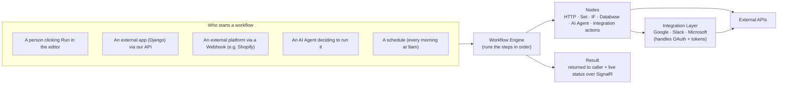

**The four big building blocks:**

| Block | Plain-English job | Status |
|---|---|---|
| **Workflow Engine** | Runs the steps of a workflow in the right order. | ✅ Built |
| **Nodes** | The individual steps (make an HTTP call, run an AI prompt, query a DB). | ✅ Built (+🧩 more) |
| **Integration Layer** | Logs in to Google/Slack/etc. once and lets every workflow reuse it. | 🧩 Planned |
| **Public API / SDK** | How outside apps (Django) and AI tools start workflows and read results. | 🧩 Planned |

---

## 2. Core concepts

These already exist in the code. Understanding them makes everything else easy.

- **Node** — one step. In code, every node implements the `INode` interface
  ([NodeAbstractions.cs](backend/WorkflowPlatform.Api/Engine/NodeAbstractions.cs)): it has a
  `Definition` (its name + the form fields the UI shows) and an `ExecuteAsync` method (what it
  actually does).
- **Trigger node** — a special node that *starts* a workflow (`IsTrigger = true`). Examples:
  Manual Trigger, Webhook Trigger.
- **Workflow** — the graph: a list of nodes + the connections (arrows) between them. Saved as JSON.
- **Workflow Version** — every save creates a version, so you can run a known-good snapshot.
- **Execution (a "run")** — one time the workflow ran. It records each node's input, output,
  status, and errors ([Entities.cs](backend/WorkflowPlatform.Api/Entities/Entities.cs)).
- **Expressions** — a node can read earlier data with `{{$json.field}}` (the current input) or
  `{{$node.NodeId.field}}` (a specific earlier node's output).

**How a run flows internally today:**

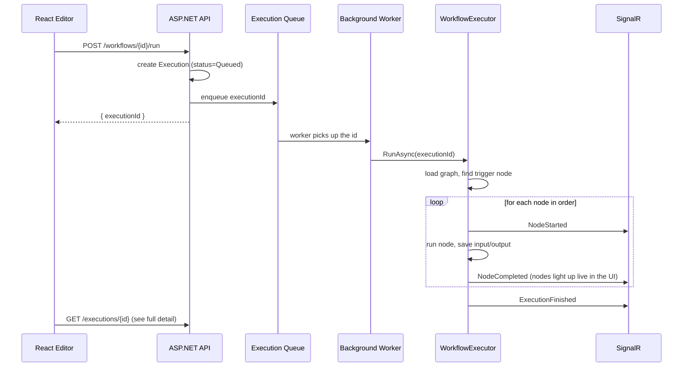

The real code for this loop is in
[WorkflowExecutor.cs](backend/WorkflowPlatform.Api/Engine/WorkflowExecutor.cs) and the queue is in
[ExecutionQueue.cs](backend/WorkflowPlatform.Api/Services/ExecutionQueue.cs).

---

## 3. Webhooks explained

### What is a webhook? (the simplest explanation)

Normally **you call an API** when you want something: "Hey Google, give me my calendar." That's
*you asking*.

A **webhook is the reverse**: *another system calls you* when something happens. It's a phone
number you give to an outside platform and say: **"Call this URL the moment something happens."**

- Regular API call = **you pull** ("do you have anything new?").
- Webhook = **they push** ("here's the new thing, right now").

**Why we need it:** workflows should react to real-world events *instantly* — a new order, a new
email, a payment — without us constantly polling and asking "anything new yet?".

### How it works in our platform (already built ✅)

We added a **Webhook Trigger node** and a **public URL** for each workflow. Any HTTP request to
that URL starts the workflow, and the request body/headers/query become the data the workflow can
read.

- Node: [WebhookTriggerNode.cs](backend/WorkflowPlatform.Api/Engine/Nodes/WebhookTriggerNode.cs)
- Public endpoint: [WebhooksController.cs](backend/WorkflowPlatform.Api/Controllers/WebhooksController.cs)
  → `POST /api/webhooks/{workflowId}/{path?}`

### Real-world example: "new order from an e-commerce platform"

**Goal:** when Shopify gets a new order, our workflow should (1) save it, (2) ask an AI to write a
friendly thank-you message, (3) post it to Slack.

**The workflow looks like this:**

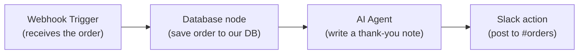

**Step 1 — Shopify calls our URL.** We registered this URL in Shopify's webhook settings:

```
POST https://your-platform.com/api/webhooks/8f3c.../order-created?token=SECRET123
Content-Type: application/json

{
  "id": 4201,
  "customer": { "first_name": "Meet", "email": "meet@example.com" },
  "total_price": "49.99",
  "line_items": [{ "title": "Blue T-Shirt", "quantity": 2 }]
}
```

**Step 2 — our platform responds immediately** (so Shopify isn't kept waiting):

```json
HTTP 202 Accepted
{ "executionId": "b7e1..." }
```

**Step 3 — the engine runs the steps.** The Webhook Trigger node emits the request as data:

```json
{
  "method": "POST",
  "query": { "token": "SECRET123" },
  "headers": { "Content-Type": "application/json" },
  "body": {
    "id": 4201,
    "customer": { "first_name": "Meet", "email": "meet@example.com" },
    "total_price": "49.99",
    "line_items": [{ "title": "Blue T-Shirt", "quantity": 2 }]
  }
}
```

- The **Database** node runs SQL using `{{$json.body.id}}` and `{{$json.body.total_price}}`.
- The **AI Agent** node uses a prompt like:
  `Write a short thank-you for {{$json.body.customer.first_name}} who ordered {{$node.Webhook.body.line_items.0.title}}.`
- The **Slack** action posts the AI's text to a channel.

**The full end-to-end picture:**

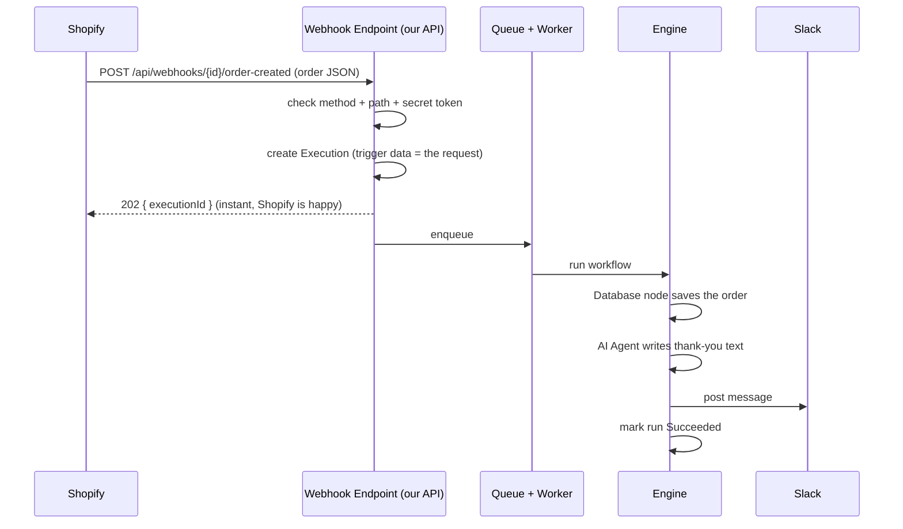

### How external platforms trigger our workflows

1. The user builds a workflow starting with a **Webhook Trigger** and activates it.
2. Our platform shows them the **URL** (and a secret token).
3. They paste that URL into the external platform's webhook settings (Shopify, Stripe, GitHub…).
4. From then on, every event there calls our URL and runs the workflow.

**Security** (already supported): an optional **secret token** must match (`?token=` or the
`X-Webhook-Token` header). Planned next: per-event signature verification (e.g. Shopify's HMAC
header) so we can prove the request really came from them.

---

## 4. AI Agents that use tools

### The problem today

Our current **AI Agent** node ([AiAgentNode.cs](backend/WorkflowPlatform.Api/Engine/Nodes/AiAgentNode.cs))
is "one-shot": prompt in → text out. It can talk, but it **cannot do things** — it can't check a
calendar, send an email, or start another workflow.

### The goal

Make the AI Agent a **real agent**: give it a set of **tools**, let it **decide** which tool(s) to
use for the user's request, call them, read the results, and keep going until the task is done.

> This is **Phase 2** of the AI node (we planned it earlier). The one-shot node stays; we add an
> "Agent" mode on top.

### What is a "tool" here?

A tool is just an action the model is *allowed* to call, described in a way the model understands
(a name, a description, and a JSON schema of its inputs). In our platform, tools come from four
places:

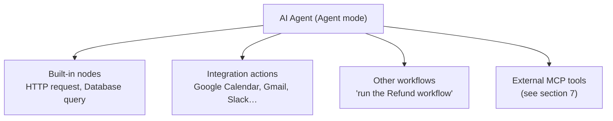

### How the agent decides and acts (the tool-calling loop)

Modern chat models support **tool calling**: you send them the list of tools, and instead of
answering, they can reply "please call tool X with these arguments." You run it, send the result
back, and they continue. Our engine runs this loop:

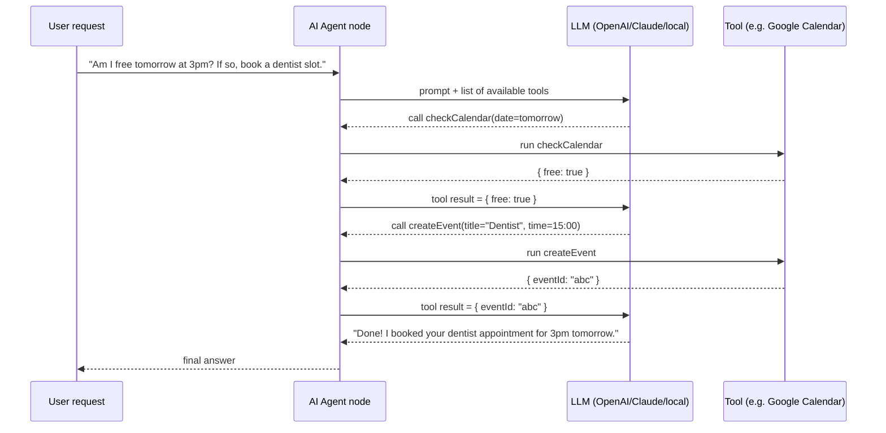

The loop has guards: a **max-iterations** cap and a **timeout**, so it can never loop forever.

### How agents, nodes, tools, and integrations communicate

Key idea: **everything is already a function in our code**, so we expose those same functions to
the model as tools.

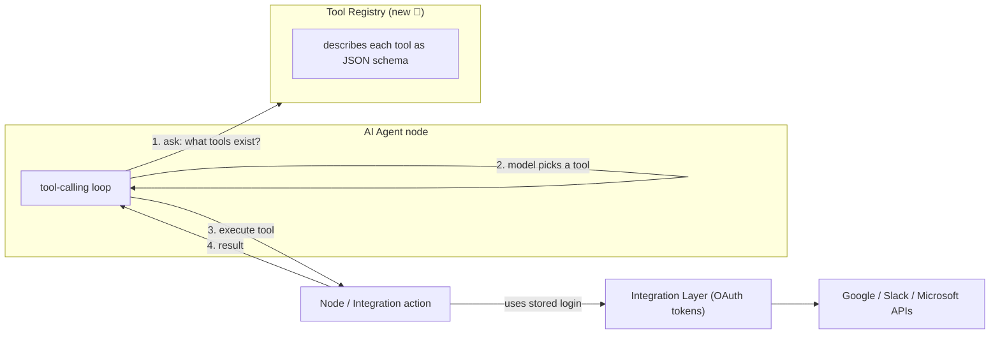

### Redesign of the AI Agent node 🧩

We add to the existing node:

- A **Mode** parameter: `Chat` (today's behavior) or `Agent`.
- A **Tools** parameter: pick which integration actions / workflows this agent may use.
- Under the hood, a new `IToolProvider` + `ToolRegistry` (mirrors the existing `NodeRegistry` and
  the provider registry we built for the AI node). Each tool exposes: `Name`, `Description`,
  `JsonSchema`, and `InvokeAsync(args)`.
- The provider interface (`IChatModelProvider`) gets a `BuildToolRequest` / `ParseToolCalls` so
  both OpenAI and Anthropic tool-calling formats are supported — same pattern we already used for
  plain chat.

---

## 5. Centralized Integration System

### The problem (your Django example)

Today, to use Google Calendar from a Django project you must write, *inside that project*:
OAuth login, token storage, token refresh, and the actual API calls. Then you do it **again** in
the next project. That's wasted, duplicated, error-prone work.

### The solution: do it **once**, here

The platform becomes the single place that:

1. Lets a user **connect their Google account once** (OAuth).
2. **Stores** the access token + refresh token **securely** (encrypted).
3. **Refreshes** tokens automatically before they expire.
4. Offers **reusable actions** (Calendar: create event; Gmail: send email; Drive: upload; Sheets:
   append row) that any workflow or AI agent can use **without any integration code**.

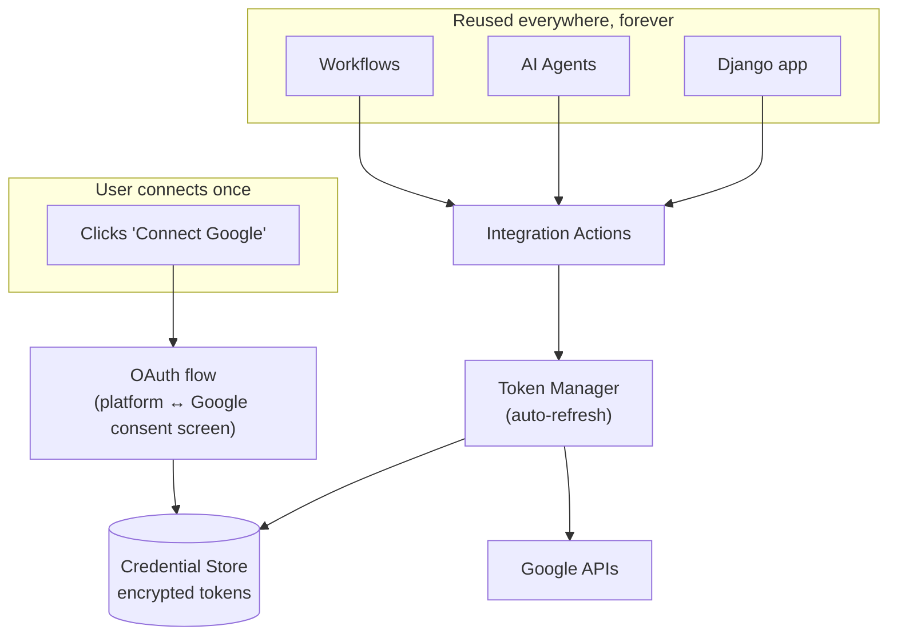

### How the "connect once" OAuth flow works

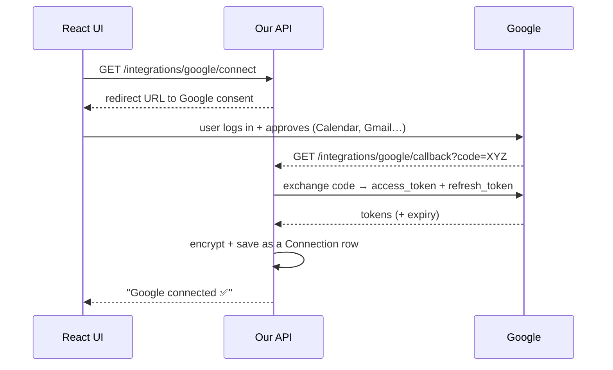

After this, the user never logs in again. When a token is about to expire, the **Token Manager**
uses the refresh token to get a new one automatically.

### Reusable actions

Each integration declares a catalog of actions. Example for Google:

| Integration | Action | Inputs | Output |
|---|---|---|---|
| Google Calendar | `createEvent` | title, start, end, attendees | eventId, htmlLink |
| Google Calendar | `listEvents` | date range | events[] |
| Gmail | `sendEmail` | to, subject, body | messageId |
| Google Drive | `uploadFile` | name, content, folder | fileId |
| Google Sheets | `appendRow` | spreadsheetId, values[] | updatedRange |

In code, an action is a small class implementing an `IIntegrationAction` interface. It gets the
decrypted token from the Token Manager and makes the call. Because actions are just registered
classes, they show up **both** as workflow nodes **and** as AI-agent tools automatically.

**Example: "create a calendar event" request the action makes for you**

```http
POST https://www.googleapis.com/calendar/v3/calendars/primary/events
Authorization: Bearer <token the platform manages for you>
Content-Type: application/json

{ "summary": "Dentist", "start": { "dateTime": "2026-11-10T15:00:00" },
  "end": { "dateTime": "2026-11-10T15:30:00" } }
```

You, as a workflow builder or Django developer, **never see or write** that — you just call the
`createEvent` action with simple inputs.

### Secure storage (important)

- Tokens are **encrypted at rest** (e.g. AES via ASP.NET Core Data Protection, or a cloud KMS).
- They are decrypted only in memory, only when an action runs.
- This replaces the MVP shortcut where secrets live in the workflow graph (the caveat flagged for
  the Database and AI nodes).

---

## 6. Using the platform from Django

### The idea

Your Django app should **not** contain integration code. It just calls our platform. We become a
**central workflow + integration service** for any number of apps.

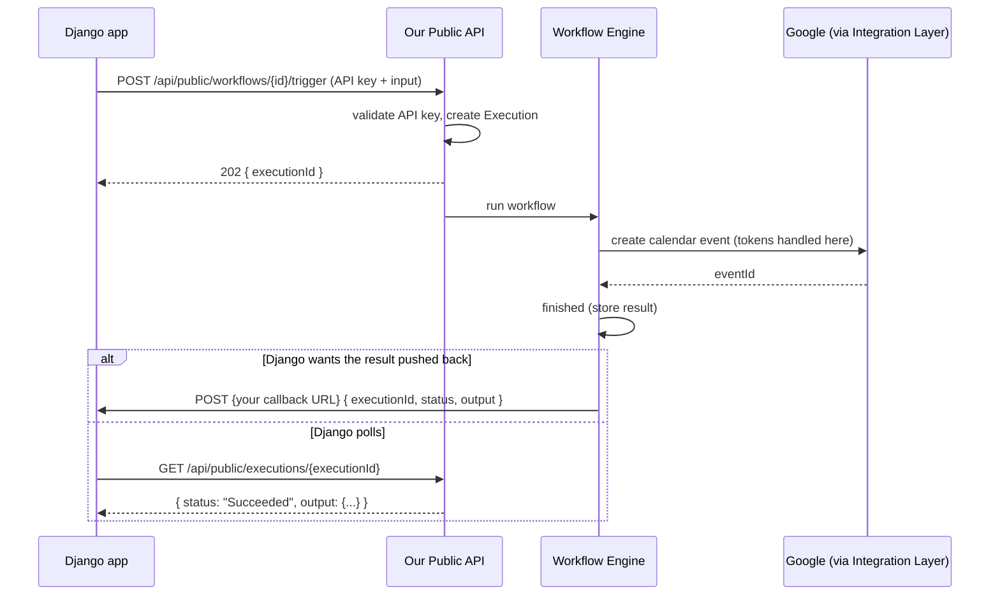

### The exact steps you described, mapped to our API

1. **User acts in Django** (e.g. clicks "Schedule meeting").
2. **Django calls us:**

   ```http
   POST https://your-platform.com/api/public/workflows/42/trigger
   Authorization: Api-Key sk_live_abc123
   Content-Type: application/json

   { "input": { "title": "Project kickoff", "time": "2026-11-12T10:00:00" },
     "callbackUrl": "https://my-django-app.com/webhooks/monkmap" }
   ```
3. **We identify the workflow** (id 42) and start it.
4. **The engine runs** the steps (including the Google Calendar action using the stored token).
5. **We return the result** — either Django **polls** `GET /api/public/executions/{id}`, or we
   **push** it to the `callbackUrl` when done:

   ```json
   POST https://my-django-app.com/webhooks/monkmap
   { "executionId": "b7e1...", "status": "Succeeded",
     "output": { "eventId": "abc", "htmlLink": "https://calendar.google.com/..." } }
   ```

### How outside apps authenticate

- **API keys** (new 🧩): each user/app gets a key (`Api-Key` header). Simple for server-to-server.
- Scopes limit what a key may do (which workflows, which integrations).
- An optional **thin SDK** (a small Python package for Django, a TypeScript package for Node) wraps
  these calls: `monkmap.trigger(workflow_id, input, wait=True)`.

> This is the same engine the webhook uses — we're just adding an **authenticated** public entry
> point beside the **anonymous** webhook one.

---

## 7. MCP support

### What is MCP in one sentence?

**MCP (Model Context Protocol)** is a standard way for AI apps and "tool servers" to talk. If a
tool server speaks MCP, *any* MCP-aware AI (Claude Desktop, IDEs, other agents) can use its tools
without custom glue — like USB-C for AI tools.

There are **two directions** we can support, and both are valuable:

### Direction A — we are an MCP **client** (our agent uses external MCP servers)

Our AI Agent connects to someone else's MCP server, lists its tools, and can call them inside the
tool-calling loop from section 4.

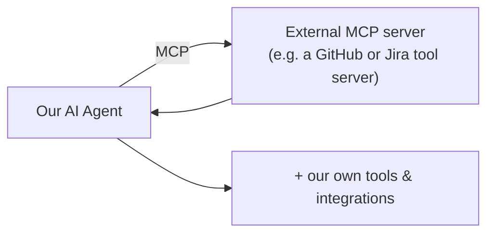

Benefit: instant access to a growing ecosystem of tools we didn't build.

### Direction B — we are an MCP **server** (we expose our stuff as MCP tools)

We publish our **workflows** and **integration actions** as MCP tools. Then external AI apps can
use *our* platform as their toolbox.

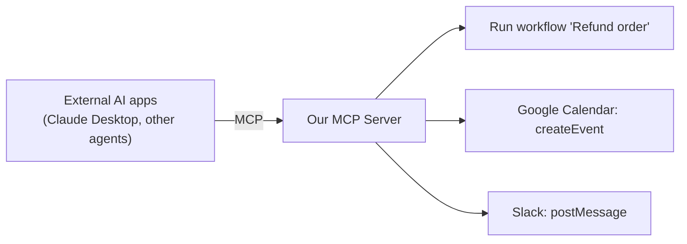

Benefit: our integration layer (the hard part — OAuth, tokens) becomes usable by *any* AI, and the
same `IIntegrationAction` / workflow definitions we already have are reused as MCP tool
definitions — no duplicate work.

### How MCP, agents, nodes, and integrations fit together

The nice part: **a tool is a tool.** We define each action/workflow once; the same definition is
surfaced three ways:

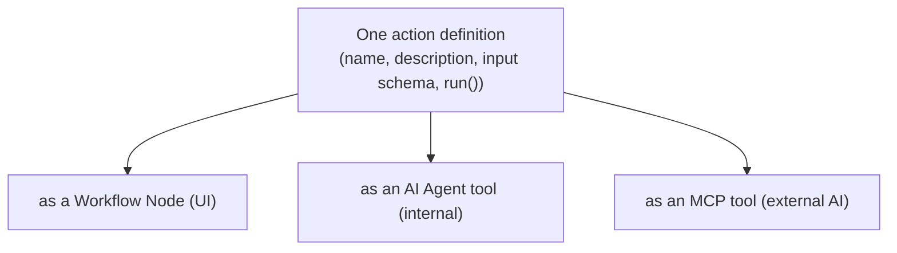

**Recommendation:** yes, include MCP — but build it *after* the Integration Layer + tool registry
exist, because MCP is a thin wrapper over those. Start with Direction A (client) since it's smaller
and immediately lets our agent do more; add Direction B (server) when we want to be a provider.

---

## 8. Database design

### What exists today ✅

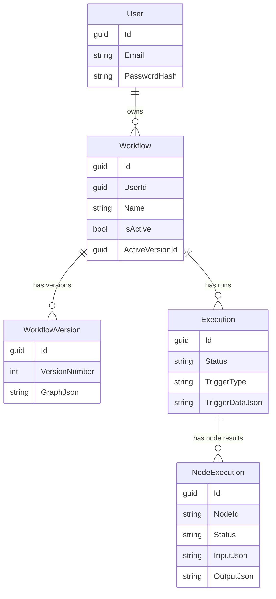

These are the real tables in [Entities.cs](backend/WorkflowPlatform.Api/Entities/Entities.cs).

### New tables for the integration + external-app features 🧩

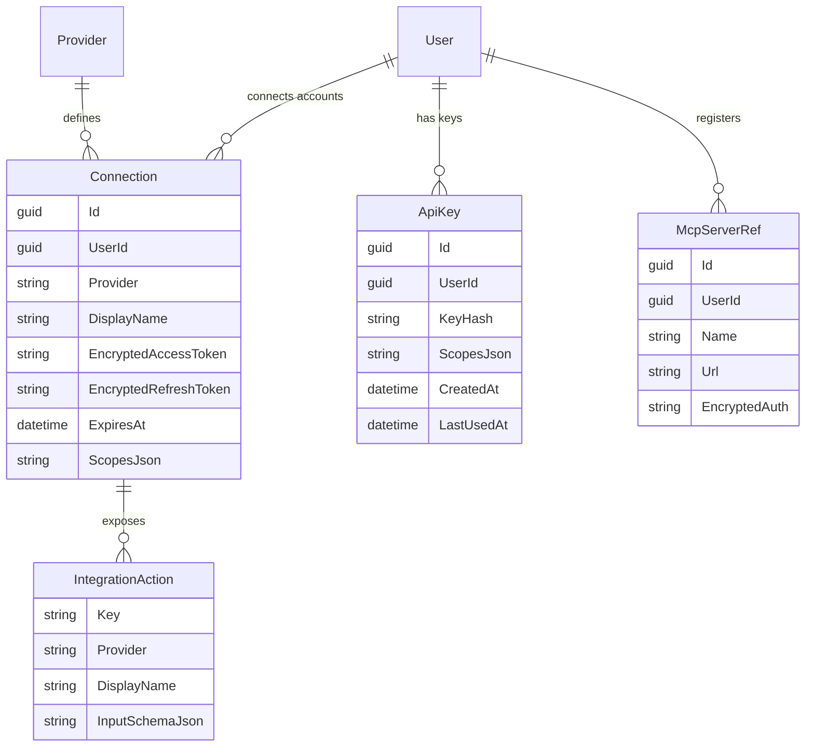

| Table | Why we need it |
|---|---|
| **Connection** | One stored login per user per provider (the encrypted Google/Slack tokens). |
| **ApiKey** | Lets Django/other apps authenticate to our public API. |
| **McpServerRef** | Remembers external MCP servers a user's agents may connect to. |
| **IntegrationAction** | Catalog of reusable actions (can be code-defined rather than a table). |

> Migration note: the app currently uses `EnsureCreated()`, which does **not** alter existing
> tables. Adding these means switching to **EF Core migrations** (`dotnet ef migrations add …`).

---

## 9. Execution lifecycle

End to end, no matter who starts it, the life of a run is the same:

1. **Trigger** — someone/something starts it: editor Run, webhook, public API, schedule, or an AI
   agent. An `Execution` row is created with `status = Queued` and the trigger payload saved in
   `TriggerDataJson`.
2. **Enqueue** — the id goes onto the queue; the API returns immediately (`202` + executionId).
3. **Pick up** — the background worker ([ExecutionQueue.cs](backend/WorkflowPlatform.Api/Services/ExecutionQueue.cs))
   dequeues the id and calls the executor.
4. **Load** — the executor reads the saved **graph version**, finds the **trigger node**, and seeds
   it with `TriggerDataJson`.
5. **Walk the graph** — for each node, in connection order:
   - mark it Running (push **NodeStarted** over SignalR → UI lights up),
   - resolve `{{ }}` expressions against earlier outputs,
   - run `ExecuteAsync`,
   - save input/output/error, push **NodeCompleted**,
   - follow the outgoing arrows (an IF node picks the `true`/`false` port).
6. **Finish** — mark the run `Succeeded` or `Failed`, push **ExecutionFinished**.
7. **Return** — caller sees live status (SignalR), or polls `GET /executions/{id}`, or gets a
   callback (section 6).

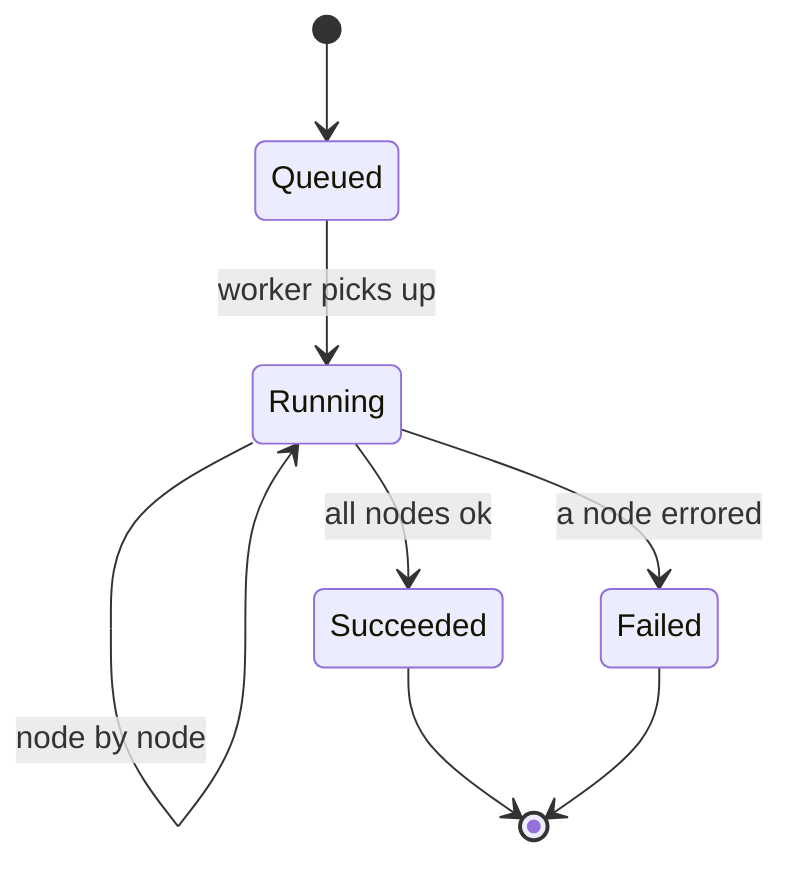

---

## 10. Modules and how to build them

Think of the system as separate modules. Each can be built and tested on its own.

| Module | Backend (ASP.NET Core) | Frontend (React) | Status |
|---|---|---|---|
| **Auth** | JWT, `AuthController`, password hashing | Login/Register pages, token in `localStorage` | ✅ |
| **Workflow CRUD + versioning** | `WorkflowsController`, EF Core | React Flow editor, Zustand store | ✅ |
| **Engine + queue** | `WorkflowExecutor`, `IExecutionQueue`, background service | live status via SignalR | ✅ |
| **Node system** | `INode` + `NodeRegistry`; palette driven by `/node-types` | auto-rendered palette + config form | ✅ |
| **Webhooks** | `WebhooksController`, `WebhookTriggerNode` | Test API console in editor | ✅ |
| **AI node (chat)** | `AiAgentNode` + provider registry | auto form (masked key field) | ✅ |
| **AI agent (tools)** | `ToolRegistry`, tool-calling loop, provider tool format | tool picker in node config | 🧩 |
| **Integration layer** | OAuth controllers, `Connection` store, Token Manager, `IIntegrationAction` | "Connections" page: connect/disconnect accounts | 🧩 |
| **Public API + SDK** | `PublicController`, API-key auth, callbacks | API-keys management page | 🧩 |
| **MCP** | MCP client in agent; MCP server endpoint exposing tools | MCP servers page | 🧩 |

### How to build a new node (the pattern you'll reuse everywhere)

This is exactly how we added the AI and Webhook nodes — it's the template for integration actions
too:

1. **Backend:** create a class implementing `INode` with a `Definition` (name + parameters) and
   `ExecuteAsync`. Register it in [Program.cs](backend/WorkflowPlatform.Api/Program.cs) with
   `builder.Services.AddSingleton<INode, YourNode>();`.
2. **Frontend:** usually **nothing** — the palette and config form are generated from
   `/api/node-types`. (Add an icon name to the two small icon maps if you want a custom icon.)

### How to build the Integration layer (recommended shape)

- **OAuth controllers** per provider: `/integrations/google/connect` and `/callback`.
- A **`ITokenManager`** that, given a `Connection`, returns a valid access token (refreshing if
  needed) — every action calls this, so refresh logic lives in **one** place.
- **`IIntegrationAction`** classes (`google.calendar.createEvent`, …). Register them like nodes.
  A tiny adapter turns each one into **both** a workflow node **and** an AI tool **and** an MCP tool
  (section 7).
- **React "Connections" page:** list providers, a "Connect" button that opens the OAuth popup, and
  a list of connected accounts with "Disconnect".

### How to build the Public API for Django

- **`PublicController`** with `[Authorize(AuthenticationSchemes = "ApiKey")]`:
  `POST /api/public/workflows/{id}/trigger` and `GET /api/public/executions/{id}`.
- **API-key middleware**: hash keys at rest, check the `Api-Key` header, attach the owning user.
- **Callbacks**: if the trigger request included a `callbackUrl`, POST the result there when the run
  finishes (reuse the same HTTP client the nodes use).

---

## 11. Roadmap

A sensible build order, each step usable on its own:

1. ✅ **Webhook trigger + test console** — done.
2. ✅ **AI chat node (multi-provider + in-house models)** — done.
3. 🧩 **Credential store + Token Manager** (encryption, refresh) — the foundation for everything
   external.
4. 🧩 **Integration layer: Google first** (Calendar, Gmail, Drive, Sheets) as reusable
   actions/nodes.
5. 🧩 **Public API + API keys + callbacks** — so Django can drive the platform.
6. 🧩 **AI Agent "tools" mode** — agent can call integration actions + run workflows.
7. 🧩 **MCP client** (agent uses external MCP servers).
8. 🧩 **MCP server** (expose our workflows/actions to external AIs).
9. 🧩 **Slack + Microsoft integrations** (same pattern as Google).

> Why this order: #3 unlocks #4; #4 + #5 deliver your Django goal; #6 makes the agent powerful; MCP
> (#7–#8) is a thin layer on top of the tool registry built in #6.

---

### One-line summary

Build the integration + token layer **once**, expose every action as a **node**, an **AI tool**,
and an **MCP tool** from a **single definition**, and let anything — the editor, a webhook, a
Django app, or an AI — start workflows through the **same engine**. That's the whole system.
