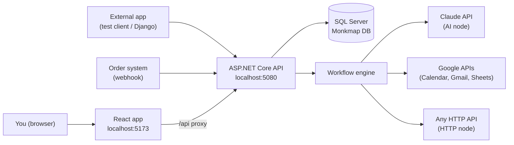
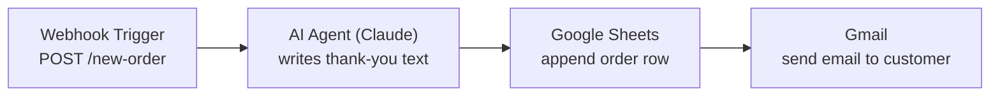

# Monkmap — Complete Testing Guide

This guide has one purpose: **you can test every part of the platform yourself**, from a
simple workflow to a real business scenario that uses Claude (AI) and Google (Calendar, Gmail,
Sheets). Each step says what to do, what you should see, and what to do if it fails.

It also explains **how the project works**, so next time you can ask for help with a precise
question.

> Companion files:
> - [ARCHITECTURE_GUIDE.md](ARCHITECTURE_GUIDE.md) — the big picture and diagrams.
> - [WEBHOOK_TESTING_PLAN.md](WEBHOOK_TESTING_PLAN.md) — how webhooks were designed.
> - [tools/monkmap-test-client/run_scenario.py](tools/monkmap-test-client/run_scenario.py) —
>   a test client that acts like an external app (like your Django project).

---

## Contents

1. [How the project works (mental model)](#1-how-the-project-works)
2. [Prerequisites](#2-prerequisites)
3. [Start the app](#3-start-the-app)
4. [Test 1 — Smoke test (is it alive?)](#4-test-1--smoke-test)
5. [Test 2 — Your first workflow (manual run)](#5-test-2--your-first-workflow)
6. [Test 3 — Webhook (an API for your workflow)](#6-test-3--webhook)
7. [Test 4 — Claude AI node (Chat mode)](#7-test-4--claude-ai-node)
8. [Test 5 — AI Agent with tools](#8-test-5--ai-agent-with-tools)
9. [Test 6 — Google connection (OAuth)](#9-test-6--google-connection)
10. [Test 7 — Google actions as workflow steps](#10-test-7--google-actions)
11. [Test 8 — Business scenario, end to end](#11-test-8--business-scenario-end-to-end)
12. [Test 9 — Run the external test client](#12-test-9--external-test-client)
13. [API reference (cheat sheet)](#13-api-reference)
14. [Troubleshooting](#14-troubleshooting)
15. [Known limitations](#15-known-limitations)

---

## 1. How the project works

### The big picture



### The words you'll see

| Word | Meaning |
|---|---|
| **Workflow** | A saved chain of steps (nodes) with arrows between them. |
| **Node** | One step, such as "call Claude" or "append a Google Sheet row". |
| **Trigger** | The node that starts a run: Manual, or Webhook (an HTTP call). |
| **Run / Execution** | One time a workflow ran. Records every node's input, output, and error. |
| **Connection** | A Google account you linked once. Its tokens are stored encrypted. |
| **Expression** | `{{$json.field}}` reads the current input. `{{$node.NODE_ID.field}}` reads an earlier step's output. |
| **Save / version** | A webhook needs at least one saved version of the workflow. (The Active switch is not enforced for webhooks yet; see limitations.) |

### What happens in one run

1. Something starts the run (you click Run, or an HTTP call hits the webhook).
2. The API saves a run record with status `Queued` and returns immediately.
3. A background worker picks it up and walks the graph, one node at a time.
4. Each node reads the previous node's output, does its job, and saves the result.
5. The run ends `Succeeded` or `Failed`. The editor shows nodes lighting up live.

### Where things live in the code

| Area | Folder |
|---|---|
| Starts workflows (manual) | `Controllers/WorkflowsController.cs` |
| Receives webhooks | `Controllers/WebhooksController.cs` |
| Runs the graph | `Engine/WorkflowExecutor.cs` |
| Nodes (steps) | `Engine/Nodes/` |
| AI providers (Claude, OpenAI) | `Engine/Providers/` |
| AI agent tools | `Engine/Tools/` |
| Google OAuth + actions | `Integrations/`, `Integrations/Actions/` |
| Connect/disconnect APIs | `Controllers/IntegrationsController.cs`, `ConnectionsController.cs` |
| Database tables | `Entities/`, `Data/AppDbContext.cs` |
| Frontend editor | `frontend/src/pages/editor/` |
| Frontend integrations page | `frontend/src/pages/Integrations.tsx` |

---

## 2. Prerequisites

| You need | Why | How to check |
|---|---|---|
| .NET SDK 10 | runs the API | `dotnet --version` |
| Node.js 20+ | runs the React app | `node --version` |
| Python 3.10+ | runs the test client (optional) | `python --version` |
| SQL Server access | database (`Monkmap`) | already set up in user secrets |
| Anthropic API key | Claude AI steps | console.anthropic.com → API keys |
| Google Cloud project | Google steps (optional) | console.cloud.google.com |

---

## 3. Start the app

You need **two terminals**.

### Terminal 1 — API

```powershell
cd "C:\Users\MeetKathiriya\source\repos\my project 2\backend\WorkflowPlatform.Api"
dotnet run
```

Wait for `Now listening on: http://localhost:5080`. The first start creates the database
tables if they don't exist yet.

> If you see `address already in use`, an older API instance is still running on 5080. Stop
> that terminal (Ctrl+C) and try again.

### Terminal 2 — React app

```powershell
cd "C:\Users\MeetKathiriya\source\repos\my project 2\frontend"
npm install        # first time only
npm run dev
```

Open **http://localhost:5173**. Vite forwards every `/api` call to the API on port 5080, so you
never need to change URLs.

---

## 4. Test 1 — Smoke test

**Goal:** confirm the API and database are alive.

**Step 1 — health check.** Open http://localhost:5080/ in the browser.

Expected:
```json
{"status":"ok","service":"WorkflowPlatform.Api"}
```

**Step 2 — create an account.** In the browser go to http://localhost:5173/register, or use:

```powershell
curl.exe -X POST http://localhost:5080/api/auth/register `
  -H "Content-Type: application/json" `
  -d '{"email":"you@example.com","password":"Passw0rd!","firstName":"You","lastName":"Test"}'
```

Expected: a JSON response with a `token` and a `user`. The token is a login badge; you only need
it for the curl examples below.

**Step 3 — check the new node types are registered:**

```powershell
curl.exe http://localhost:5080/api/node-types -H "Authorization: Bearer <TOKEN>"
```

Expected list of types: `ManualTrigger`, `WebhookTrigger`, `Set`, `HttpRequest`, `If`,
`Database`, `AiAgent`, `IntegrationAction`.

✅ **Pass:** all three checks return what's listed above.

---

## 5. Test 2 — Your first workflow

**Goal:** build a workflow in the editor and run it.

**Step 1.** Log in at http://localhost:5173. Go to **Workflows → New workflow**.

**Step 2.** From the left palette, add:
- **Manual Trigger**
- **HTTP Request**

**Step 3.** Connect them: drag from the right handle of Manual Trigger to the left handle of
HTTP Request.

**Step 4.** Click **HTTP Request** and set:
- Method: `GET`
- URL: `https://jsonplaceholder.typicode.com/todos/1`

**Step 5.** Click **Run** (top right). The workflow saves itself first.

**Step 6.** Watch the nodes turn green. Click **View run** and open the HTTP node. You should see
its output, including `"title"`.

✅ **Pass:** the run shows `Succeeded` and the HTTP output has a `title` field.

**Try a failure:** change the URL to `https://example.invalid/`. The run should show `Failed`
with the error on the HTTP node. This confirms failures are reported correctly.

---

## 6. Test 3 — Webhook

**Goal:** give a workflow its own API endpoint and call it from outside, like a real order
system would.

**Step 1.** Create a new workflow. Add a **Webhook Trigger** node and set:
- HTTP method: `POST`
- Path: `new-order`
- Secret token: `test-secret-123`

**Step 2.** Add a **Set** node after it (any simple field is fine) and connect them.

**Step 3.** Click **Save**. The webhook needs a saved version. Turning on **Active** is good
practice, but the webhook doesn't check that switch yet (see [Known limitations](#15-known-limitations)).

**Step 4.** Open the **Test API** tab on the right. Copy the endpoint, or the cURL snippet, and
click **Send request**.

Or call it yourself with your workflow id (from the URL `/workflows/<ID>/editor`):

```powershell
curl.exe -X POST "http://localhost:5080/api/webhooks/<WORKFLOW_ID>/new-order?token=test-secret-123" `
  -H "Content-Type: application/json" `
  -d '{"order_id":"ORD-1001","customer":{"name":"Asha Patel","email":"asha@example.com"},"total":"149.00"}'
```

Expected response: `HTTP 202` with `{"executionId":"..."}`.

**Step 5.** Check the run:

```powershell
curl.exe http://localhost:5080/api/executions/<EXECUTION_ID> -H "Authorization: Bearer <TOKEN>"
```

Or open the run in the app. Then look at the trigger node's output: it contains `body`, `query`,
`headers`, and `method`. Your order is in `body`.

**Negative tests** (each should be rejected):

| Call | Expected |
|---|---|
| No `token` | `401 Invalid or missing webhook token.` |
| Wrong token | `401` |
| `GET` instead of `POST` | `405 This webhook accepts POST.` |
| Workflow never saved (wrong id) | `404 No active workflow for this webhook URL.` |

✅ **Pass:** valid call → 202 and a successful run; each negative call is refused as listed.

---

## 7. Test 4 — Claude AI node

**Goal:** have Claude write text, using your Anthropic key.

**Step 1 — get a key.** Go to console.anthropic.com → **API keys** → create a key. Copy it once.
Keep it private.

**Step 2 — build the workflow.** Create a new workflow with:
1. **Manual Trigger**
2. **AI Agent** node, set:
   - Mode: `Chat`
   - Provider: `Anthropic (Claude)` (shown as `Anthropic` in the dropdown)
   - Model: `claude-haiku-5-5` (cheap and fast; use any model your account can access)
   - API key: your key (the field is masked)
   - System prompt: `You write short, friendly, plain-text messages.`
   - User prompt: `Write a one-sentence greeting for a customer named Asha.`
   - Temperature: `0.4`, Max tokens: `200`

> Model names change over time. If you get `HTTP 404` or `model not found`, check the model list
> in your Anthropic console and paste an available one.

**Step 3 — run it** (click **Run**). Open **View run** → the AI node's output.

Expected output shape:
```json
{ "text": "Hello Asha, ...", "model": "claude-haiku-5-5", "provider": "Anthropic (Claude)", "mode": "chat" }
```

**Step 4 — test expressions.** Put this in the User prompt of a later node:
`{{$node.<AI_NODE_ID>.text}}`. To find an ID, open the run detail page: each node shows its
`nodeId`.

✅ **Pass:** the output `text` contains a real greeting written by Claude.

**Common failures:**
- `HTTP 401` → the key is wrong or copied with spaces.
- `HTTP 400 ... credit` → your Anthropic account has no credit yet.
- `Model request timed out` → try a smaller `Max tokens`, or retry.

---

## 8. Test 5 — AI Agent with tools

**Goal:** let Claude **decide** which tool to use: fetch a web page, or run one of your other
workflows.

**Step 1.** Create a workflow with **Manual Trigger → AI Agent**. Set:
- Mode: `Agent`
- Provider / model / API key: as in Test 4
- System prompt: `You are a helpful assistant. Use tools when you need live data.`
- User prompt: `Fetch https://jsonplaceholder.typicode.com/todos/1 and tell me the title.`
- Max tool steps: `6`

**Step 2 — run it.** The agent should call the `http_request` tool, read the result, and answer.

Look at the output: `steps` lists each tool call (name, arguments, result), and `text` is the
final answer.

Expected: `"mode": "agent"`, one step with `"tool": "http_request"`, and a final `text` that
mentions the todo title.

**Step 3 — test `run_workflow`.** Copy the id of the workflow from Test 2 (from its URL). Then
set the prompt to:
`Run the workflow with id <THAT_ID> and tell me its status.`

The agent should call `run_workflow`, which runs that workflow and returns its output.

✅ **Pass:** `steps` contains a tool call and the final answer uses its result.

> The agent can call any integration action too, once you've connected Google (Test 6). For
> example: *"Add a calendar event called Standup tomorrow at 9am."*

---

## 9. Test 6 — Google connection

**Goal:** link your Google account once so workflows and the agent can use it.

### Part A — create Google credentials (one time)

1. Go to **console.cloud.google.com** → select or create a project (for example
   `monkmap-dev`).
2. **APIs & Services → Library.** Search for and enable:
   - **Google Calendar API**
   - **Gmail API**
   - **Google Sheets API**
3. **APIs & Services → OAuth consent screen.**
   - User type: **External** → Create.
   - App name: `Monkmap Dev`. Support email: your email. Developer contact: your email.
   - Scopes: you can skip this step.
   - **Test users:** add **your own Google email**. Only test users can connect while the app is in
     "Testing" mode.
4. **APIs & Services → Credentials → Create credentials → OAuth client ID.**
   - Application type: **Web application**.
   - Name: `Monkmap local`.
   - **Authorized redirect URIs:** add exactly
     `http://localhost:5080/api/integrations/google/callback`
   - Create. Copy the **Client ID** and **Client secret**.

> Testing-mode caveat: Google expires refresh tokens for apps in "Testing" after about 7 days. If
> Google actions stop working after a week, reconnect the account on the Integrations page.

### Part B — give the keys to the app

The secret must not go into `appsettings.json` or git. Put it in user secrets from
`backend/WorkflowPlatform.Api`:

```powershell
cd "C:\Users\MeetKathiriya\source\repos\my project 2\backend\WorkflowPlatform.Api"
dotnet user-secrets set "Integrations:Google:ClientId" "PASTE_CLIENT_ID"
dotnet user-secrets set "Integrations:Google:ClientSecret" "PASTE_CLIENT_SECRET"
```

Restart the API (Ctrl+C, then `dotnet run`).

### Part C — connect

1. Open http://localhost:5173/integrations.
2. The Google card should show **Connect** (not "Not configured").
3. Click **Connect** → sign in with the test-user Google account → approve the permissions.
4. You are returned to the Integrations page, which shows **"Connected google ✓"**.
5. Under **Connected accounts**, copy the **Connection id**. You'll need it in Test 7.

Verify with curl:
```powershell
curl.exe http://localhost:5080/api/connections -H "Authorization: Bearer <TOKEN>"
```

✅ **Pass:** the connection appears with your Google email as `accountName`.

**If Google shows "This app is blocked" or "access_denied":** your Google email isn't in the test
users list, or the redirect URI doesn't match exactly (including `http`, the port, and no trailing
slash).

---

## 10. Test 7 — Google actions

**Goal:** use Google from a workflow step, with no Google code.

Each action has a fixed input. Put it in the **Input (JSON)** field of an **Integration Action**
node.

| Action | Input example | What it does |
|---|---|---|
| `google.calendar.listEvents` | `{"maxResults": 5}` | Lists your next 5 events |
| `google.calendar.createEvent` | `{"summary":"Standup","start":"2026-11-12T09:00:00","end":"2026-11-12T09:15:00","timeZone":"Asia/Kolkata"}` | Creates an event on your primary calendar |
| `google.gmail.sendEmail` | `{"to":"you@example.com","subject":"Test","body":"Hello from Monkmap"}` | Sends an email from your Gmail |
| `google.sheets.appendRow` | `{"spreadsheetId":"SHEET_ID","range":"Sheet1","values":["a","b","c"]}` | Adds a row to a sheet |

### Test A — list calendar events (safest first test)

1. New workflow: **Manual Trigger → Integration Action**.
2. Integration Action settings:
   - Action: `google.calendar.listEvents`
   - Connection id: the id from Test 6
   - Input: `{"maxResults": 5}`
3. Run. Open the run → the output contains an `items` array of your events.

### Test B — create a calendar event

Same as Test A, with action `google.calendar.createEvent` and the create input above. Then open
Google Calendar in your browser and check that the event exists.

### Test C — append to a Google Sheet

1. Create a blank Google Sheet. Rename the first tab `Sheet1`.
2. Copy its id from the URL: `docs.google.com/spreadsheets/d/<SHEET_ID>/edit`.
3. Run `google.sheets.appendRow` with that `spreadsheetId`.
4. Refresh the sheet. A new row appears.

> Google Sheets needs the Sheets scope. If you see a 403 error about scopes, disconnect the
> account on the Integrations page and connect again so the new permissions are granted.

### Test D — send an email

Run `google.gmail.sendEmail` with `to` set to an address you can check. Check the Sent folder and
the inbox.

✅ **Pass:** each action's run shows `Succeeded`, and the change appears in Google.

---

## 11. Test 8 — Business scenario end to end

**The business case:** a shop receives a new order. Automatically:

1. Our platform receives the order from the shop's system (**webhook**).
2. Claude writes a personal thank-you email (**AI node**).
3. The order is logged in a Google Sheet (**Sheets action**).
4. The thank-you email is sent to the customer (**Gmail action**).

### The workflow



### Step 1 — build it in the editor

Create a workflow named **New order processing** and add these nodes in order.

**Node 1 — Webhook Trigger**
- Method: `POST` · Path: `new-order` · Secret token: `test-secret-123`

**Node 2 — AI Agent** (node id `ai`, shown in the run view)
- Mode: `Chat` · Provider: `Anthropic` · Model: `claude-haiku-5-5` · API key: your key
- System prompt: `Write short, friendly, plain-text emails. No quotation marks, no markdown.`
- User prompt:
  ```
  Write a 3-sentence thank-you email to {{$json.body.customer.name}} for order
  {{$json.body.order_id}} totalling {{$json.body.total}} USD.
  ```

**Node 3 — Integration Action** (Sheets)
- Action: `google.sheets.appendRow` · Connection id: yours
- Input:
  ```json
  {
    "spreadsheetId": "YOUR_SHEET_ID",
    "range": "Orders",
    "values": ["{{$json.body.order_id}}", "{{$json.body.customer.name}}", "{{$json.body.total}}"]
  }
  ```

**Node 4 — Integration Action** (Gmail)
- Action: `google.gmail.sendEmail` · Connection id: yours
- Input:
  ```json
  {
    "to": "YOUR_TEST_EMAIL",
    "subject": "Thanks for your order {{$json.body.order_id}}",
    "body": "{{$node.ai.text}}"
  }
  ```

> Replace `ai` in `{{$node.ai.text}}` with the **real node id** of your AI node. Find it in the
> run view, where each node shows its `nodeId`. Node ids look like `AiAgent_1_123`.

Connect the four nodes in a straight line, then **Save** and turn on **Active**.

Create a sheet tab named `Orders` (the range above). Make sure its first row has headers if you
want them to stay readable.

### Step 2 — send an order (like the shop's system would)

```powershell
curl.exe -X POST "http://localhost:5080/api/webhooks/<WORKFLOW_ID>/new-order?token=test-secret-123" `
  -H "Content-Type: application/json" `
  -d '{"order_id":"ORD-2001","customer":{"name":"Asha Patel","email":"you@example.com"},"total":"149.00"}'
```

Expected: `202` with an `executionId`.

### Step 3 — verify each step

| Where to look | What you should see |
|---|---|
| Run view | 4 nodes, all `Succeeded` |
| AI node output | `text` with a 3-sentence email to Asha |
| Google Sheet `Orders` tab | new row: `ORD-2001 · Asha Patel · 149.00` |
| Your inbox | email with subject `Thanks for your order ORD-2001` |

✅ **Pass:** all four steps succeed and the row and email exist.

### Step 4 — test the failure path

Send an order with a missing customer, for example
`{"order_id":"ORD-2002","total":"10"}`. The AI prompt resolves `customer.name` to an empty string,
and the email step should still run with a sensible body. Then remove the **Gmail** node's
connection id and resend the order. The run should show `Failed` on the Gmail node, with the
error message visible in the run view. Sheets should still have its row, because it ran earlier.

---

## 12. Test 9 — External test client

Everything above used the editor. The external test client does the same thing with code, as an
outside app would. Use it to test your integration from another project.

### What it does

[`run_scenario.py`](tools/monkmap-test-client/run_scenario.py):
1. Logs in (or registers) with `MONKMAP_EMAIL` / `MONKMAP_PASSWORD`.
2. Creates a workflow via the API and saves the business graph (only the steps whose settings you
   provide).
3. Activates the workflow.
4. Sends an order to the webhook.
5. Waits for the run and prints every node's status.

It uses only Python's standard library, so there's nothing to install.

### Run it

Set your values once in the same PowerShell window, then run:

```powershell
cd "C:\Users\MeetKathiriya\source\repos\my project 2\tools\monkmap-test-client"

$env:MONKMAP_URL        = "http://localhost:5080"
$env:ANTHROPIC_API_KEY    = "sk-ant-..."           # enables the AI step
$env:GOOGLE_CONNECTION_ID = "paste-connection-id"   # enables Sheets + Gmail
$env:SHEET_ID             = "your-sheet-id"
$env:CUSTOMER_EMAIL       = "you@example.com"

python run_scenario.py
```

Leave out a variable to skip that part. With nothing set, it still runs the webhook-only path,
which is a useful first check.

Expected output (full run):
```
[auth] logged in as tester@example.com
[workflow] created 3f2a...
[workflow] saved with steps: WebhookTrigger -> AiAgent -> IntegrationAction -> IntegrationAction
[workflow] activated
[webhook] accepted order ORD-A1B2C3 -> run 9e0d...

[run] final status: Succeeded
  - webhook    WebhookTrigger     Succeeded
  - ai         AiAgent            Succeeded
  - sheet      IntegrationAction  Succeeded
  - gmail      IntegrationAction  Succeeded
```

> Note: the test client writes your Anthropic key into the saved workflow. That's the MVP
> behavior for every node. Don't share the database.

### Use it as a template for your Django app

The pattern is the same as in your Django app:
1. Log in once and keep the token.
2. Trigger a workflow with an HTTP call (here, the webhook).
3. Poll `GET /api/executions/{id}`, or receive the result, and act on it.

---

## 13. API reference

All paths are under `http://localhost:5080`. "Auth" means send
`Authorization: Bearer <TOKEN>`.

| Method | Path | Auth | Purpose |
|---|---|---|---|
| GET | `/` | no | health check |
| POST | `/api/auth/register` | no | create account → token |
| POST | `/api/auth/login` | no | log in → token |
| GET | `/api/node-types` | yes | list the node types and their settings |
| GET | `/api/workflows` | yes | list your workflows |
| POST | `/api/workflows` | yes | create `{name, description}` |
| GET | `/api/workflows/{id}` | yes | get a workflow and its graph |
| PUT | `/api/workflows/{id}` | yes | save `{name, description, graphJson}` (creates a version) |
| POST | `/api/workflows/{id}/activate?active=true` | yes | turn webhooks on/off |
| POST | `/api/workflows/{id}/run` | yes | run manually `{triggerDataJson}` → `{executionId}` |
| POST | `/api/webhooks/{id}/{path}?token=...` | token only | webhook entry point → `202 {executionId}` |
| GET | `/api/executions` | yes | list recent runs |
| GET | `/api/executions/{id}` | yes | run detail with each node's input/output/error |
| GET | `/api/integrations` | yes | providers, connection status, and actions |
| GET | `/api/integrations/google/connect-url` | yes | URL to start Google sign-in |
| GET | `/api/integrations/google/callback` | Google | OAuth return (automatic) |
| GET | `/api/connections` | yes | your connected accounts (no tokens shown) |
| DELETE | `/api/connections/{id}` | yes | disconnect an account |

### A saved workflow's `graphJson`

```json
{
  "nodes": [
    { "id": "webhook", "type": "WebhookTrigger", "position": {"x":0,"y":0},
      "parameters": { "method": "POST", "path": "new-order", "token": "test-secret-123" } },
    { "id": "ai", "type": "AiAgent", "position": {"x":240,"y":0},
      "parameters": { "mode": "Chat", "provider": "Anthropic", "model": "claude-haiku-5-5",
                      "apiKey": "sk-ant-...", "prompt": "Hello {{$json.body.customer.name}}" } }
  ],
  "connections": [
    { "id": "e1", "source": "webhook", "target": "ai", "sourceHandle": "main", "targetHandle": "main" }
  ]
}
```

Each node's `id` is what `{{$node.<id>.field}}` uses.

---

## 14. Troubleshooting

| Symptom | Likely cause | Fix |
|---|---|---|
| `address already in use :5080` | an old API is still running | stop the old terminal (Ctrl+C) |
| `Login failed for user 'developer'` | wrong SQL password | check `dotnet user-secrets list` |
| Page shows the login screen again and again | token expired or API down | log in again; check the API is running |
| Connect button says **Not configured** | Google ClientId/Secret not set | Test 6, Part B |
| Google `redirect_uri_mismatch` | redirect URI differs in Google console | must be exactly `http://localhost:5080/api/integrations/google/callback` |
| Google `access_denied` / "blocked" | your email isn't a test user | add it under OAuth consent screen → Test users |
| Google actions fail after a week | Testing-mode refresh token expired | reconnect on the Integrations page |
| `No connected google account` | the agent's tool needs a Google connection | connect on the Integrations page |
| Webhook returns `404` | workflow never saved, or wrong id/path | Save the workflow; check the id and path in the URL |
| Webhook returns `401` | missing or wrong `token` | include `?token=` exactly as set in the node |
| AI node: `HTTP 401` | bad Anthropic key | create a new key; check for spaces |
| AI node: `HTTP 404` on model | model name not available to your key | use a model from your console |
| AI node: `credit balance` error | no Anthropic credit | add credit in the console |
| Run `Failed`: `Input is not valid JSON` | a JSON input has a syntax error | check commas and quotes in the input |
| Email/Sheet step gets empty values | expression points at the wrong node or field | check the run view for the real `nodeId` and output shape |
| Run stays `Queued` | the background worker isn't running | restart the API; check the console for errors |

---

## 15. Known limitations

These are real gaps in the current MVP. None of them block the tests above, but you should know
them:

1. **Node ids aren't shown in the editor.** You find them in the run view. A "copy reference"
   button would help.
2. **API keys are stored in the workflow graph.** Fine for testing. Before real users, move them
   to an encrypted credentials store (roadmap item 3).
2a. **The Active switch isn't enforced for webhooks.** Any saved workflow accepts webhook calls.
   Add a check in `WebhooksController` if you want Active to gate them.
3. **Schema changes use EF migrations.** On startup the app applies any pending migrations
   (`Data/Migrations/`). Existing data is kept. Migrations are generated for SQL Server, so another
   database provider would need its own set.
4. **Expressions in text fields are plain substitution.** Inside JSON inputs, each value is
   resolved on its own, so quotes in AI output are safe. Other text fields are not escaped.
5. **Google refresh tokens** follow Google's Testing-mode expiry (about 7 days).
6. **Only the four Google actions exist** so far. Slack and Microsoft are the next roadmap items.

---

### Quick checklist for next time

When you ask for help, paste:
- the step number from this guide that failed,
- the exact error text (from the editor, the run view, or the API console),
- and the node's settings with secrets removed.

That's enough to find the problem fast.
